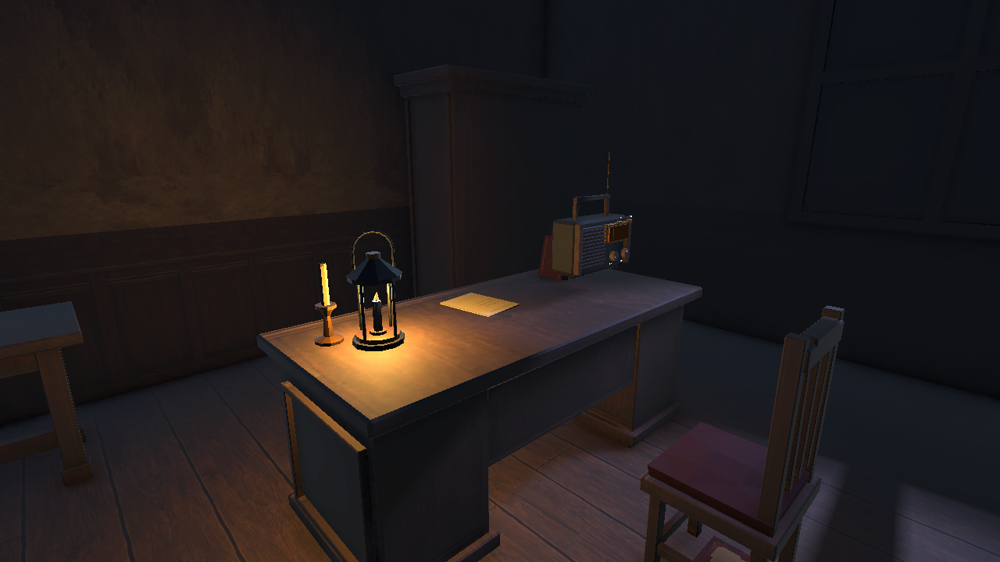

# Echo

**Стелс-пригода від першої особи, у якій звук підказує, як рухатися й що робити далі.**

Уночі в старому маєтку гравець знаходить радіо. Передачі, записки та предмети відкривають шлях до нових кімнат, поки мешканець патрулює будинок і перевіряє джерела шуму. Мета гравця — зібрати все необхідне для ліків і непомітно залишити їх мешканцю.



## Грати на Windows

1. Завантаж [Echo-Windows-x64.zip](https://github.com/Seethl/Echo/releases/download/prototype-windows-8492d3d5/Echo-Windows-x64.zip) зі сторінки [GitHub Releases](https://github.com/Seethl/Echo/releases/tag/prototype-windows-8492d3d5).
2. Розпакуй весь архів в окрему папку.
3. Запусти `Echo.exe` з цієї папки й обери **Нова гра**.

Unity для запуску готової гри не потрібна. Це попередня збірка з коміту `8492d3d5`. Подальші зміни доступні у вихідному проєкті в гілці `main`.

## Що є в грі

- **Звукові головоломки.** Налаштовуй радіо, прибирай перешкоди для прийому та зіставляй звуки передачі з вініловими платівками. Код замка в галереї змінюється з новою грою.
- **Стелс.** Мешканець реагує на шум і помічає гравця в полі зору. Килими приглушують кроки, а шум води допомагає приховати роботу із засувом.
- **Дослідження маєтку.** Відчиняй фізичні двері, працюй із механізмами, шукай рецепт і складники в кімнатах та саду. У маєтку є прихована записка для музикантів.
- **Український інтерфейс і звук.** Передачі озвучила команда. Субтитри й журнал дають змогу повернутися до отриманих підказок. Фонова музика тихішає, поки грає радіо або платівка.

## Керування

| Клавіша | Дія |
| --- | --- |
| `WASD` або стрілки | Рух |
| Миша | Огляд |
| Лівий `Shift` | Біг |
| Лівий `Ctrl` | Присісти |
| `E` | Взаємодія з предметом під прицілом |
| `R` / `F` | Налаштувати радіо / увімкнути або вимкнути радіо в руках |
| `J` | Журнал підказок |
| Коліщатко або `Alt` + `↑` / `↓` | Вибір предмета в інвентарі |
| `Esc` | Закрити панель або відкрити паузу |

## Запуск із вихідного коду

Потрібні **Unity 6000.6.7f1**, Git і Git LFS. Великі аудіофайли та моделі зберігаються в LFS.

```sh
git lfs install
git clone https://github.com/Seethl/Echo.git
cd Echo
git lfs pull
```

Додай кореневу папку `Echo` в Unity Hub, відкрий її у вказаній версії редактора й дочекайся імпорту. Відкрий сцену `Assets/Scenes/MainMenu/MainMenu.unity`, натисни **Play** та обери **Нова гра**.

Для власної Windows-збірки відкрий **File → Build Profiles**, вибери **Windows x64** і перевір, що `MainMenu` стоїть першою, а `ManorPrototype` входить до списку сцен. Натисни **Build** і вибери окрему папку. Для поширення запакуй усю папку збірки разом із `Echo.exe`.

Ігровий код на C# лежить у [`Assets/Scripts`](Assets/Scripts). Вихідні матеріали зібрані в [`ArtSource`](ArtSource), а технічні описи та джерела звуків — у [`Docs`](Docs).
